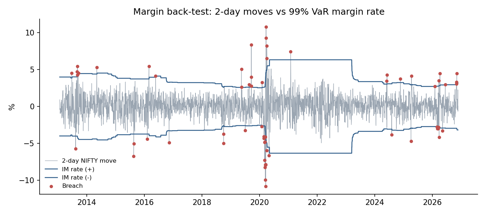
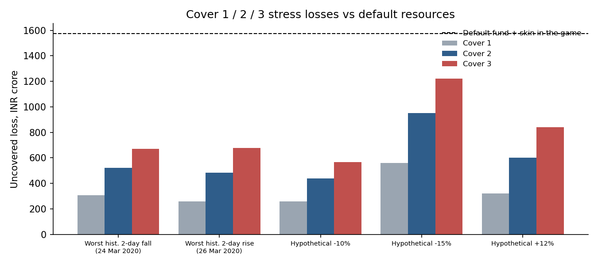
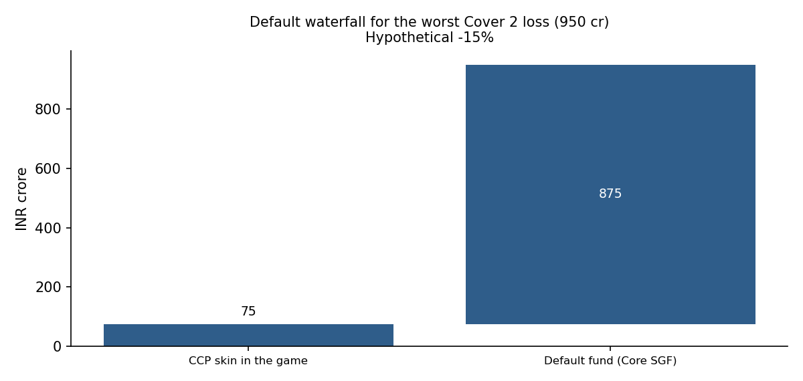

# CCP Margin & Default Fund Stress Test

A simplified model of how a clearing house protects itself when members holding NIFTY index futures default.

## What it does

1. **Initial margin:** 99% historical VaR on 2-day NIFTY returns (the margin period of risk), plus a 2% extreme loss margin.
2. **Back-test:** every day, sets the margin rate from the previous 3 years and checks whether the next 2-day move beat it. A 99% model should be breached about 1% of the time on each side.
3. **Stress scenarios:** the worst 2-day fall and rise in the data, plus hypothetical shocks of −10%, −15% and +12%.
4. **Uncovered loss** for each of 10 hypothetical clearing members = stress loss − margin held.
5. **Cover 1 / 2 / 3 test:** can the default fund plus the CCP's skin in the game absorb the default of the 1, 2 or 3 members with the biggest uncovered losses?
6. **Default waterfall:** shows which layer absorbs the worst Cover 2 loss.

## How to run (Mac)

```bash
cd stress_test
pip3 install pandas numpy matplotlib yfinance
python3 ccp_stress_test.py
```

The script downloads NIFTY 50 history (`^NSEI`) from Yahoo Finance and saves it to `data/nifty.csv`. You can instead put your own CSV there with `Date` and `Close` columns. If neither works, it runs on **simulated** prices so the code can still be tested; `output/data_source.txt` always says which data was used.

## Outputs (`output/`)

| File | Contents |
|---|---|
| `member_margins.csv` | Initial margin and extreme loss margin per member |
| `uncovered_losses.csv` | Loss beyond margin for each member under each scenario |
| `cover_test.csv` | Cover 1/2/3 losses and whether resources are enough |
| `waterfall.csv` | How the worst Cover 2 loss runs through the waterfall |
| `backtest.png`, `cover_test.png`, `waterfall.png` | Charts |

## Assumptions and limits

- Member positions, the ₹1,500 cr default fund, 5% skin in the game and the waterfall layer sizes are **made up** for illustration; they are not NSE Clearing's figures.
- Single product (NIFTY futures), so there are no portfolio offsets as in SPAN.
- Members default at the same moment as the shock; no liquidity, wrong-way or concentration add-ons.
- NSE Clearing's real derivatives margin uses SPAN calibrated to a 1-day 99% VaR plus extreme loss margin; this model uses a 2-day horizon, closer to European (EMIR) practice for exchange-traded derivatives.

## Results (real NIFTY 50 data, Jan 2010 – Nov 2026, 4,149 days)

| Item | Result |
|---|---|
| IM rate (99% VaR, 2-day) | 3.69% of notional, plus 2% extreme loss margin |
| Back-test | 62 breaches in 3,397 days = **1.83%** (about 2% expected for a two-sided 99% model) |
| Worst historical 2-day moves | −10.8% (to 24 Mar 2020) and +10.8% (to 26 Mar 2020) |
| Worst Cover 2 loss | ₹950 cr in the −15% shock (CM06 + CM01 default) |
| Worst Cover 3 loss | ₹1,220 cr in the −15% shock |
| Default fund held | ₹1,500 cr (+ ₹75 cr skin in the game): **passes Cover 1, 2 and 3 in every scenario** |
| Waterfall, worst Cover 2 loss | Skin in the game absorbs ₹75 cr, default fund ₹875 cr; no assessment or haircut needed |





## What the results show

- **The margin model is well calibrated overall** (1.83% breaches vs about 2% expected), but **breaches cluster** in March 2020. A model built on past data reacts late to a sudden crisis, which is why CCPs also hold a default fund.
- **Procyclicality:** after COVID the margin rate jumped from about 2.6% to 6.3%, which would have hit members with large margin calls at the worst moment. It then stayed high for three years and fell sharply in 2023, when the crisis left the 3-year look-back window. Real CCPs use anti-procyclicality tools (margin floors, a stressed-period weight, buffers) to smooth this.
- **Horizon matters:** NIFTY's worst single day (−13% on 23 Mar 2020) is bigger than its worst 2-day move (−10.8%), because a rebound followed. Using several horizons gives a fuller stress picture.
- **The fund is oversized for this book:** Cover 3 needs ₹1,220 cr against ₹1,500 cr held (about 1.2x). That is similar to NSE Clearing's equity-derivatives Core SGF being about 1.2x its ₹10,500 cr floor.
